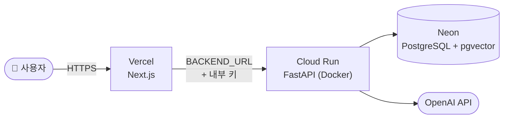

# 배포 가이드

현재 배포 구성이다.

| 구성 | 호스팅 | 주소 |
|---|---|---|
| 프런트엔드 (Next.js, `frontend/`) | Vercel | https://global-in-outsiders.vercel.app ← 공유할 주소 |
| 백엔드 (FastAPI, 루트 `Dockerfile`) | Google Cloud Run (`australia-southeast1`) | https://global-in-api-lugzdzxsda-ts.a.run.app |
| 정책 DB (PostgreSQL + pgvector) | Neon (`aws-ap-southeast-2`, 시드니) | 비공개 |



브라우저는 프런트엔드만 호출한다. 프런트엔드 서버가 `INTERNAL_API_KEY`를 붙여 백엔드를 호출하므로 이 키는 브라우저에 노출되지 않는다. 백엔드 주소는 공개돼 있지만 키 없는 내부·상담 API 호출은 401로 거부된다.

## 비밀값 파일 (git에 올라가지 않음)

| 파일 | 내용 | 만드는 방법 |
|---|---|---|
| `.env.local` | `DATABASE_URL`(pooled), `DATABASE_URL_UNPOOLED`(direct) | `neon link` (아래 1단계) |
| `.env.deploy` | `INTERNAL_API_KEY`, `CONSULT_OWNER_SECRET`, `OPENAI_API_KEY` | 직접 작성. 키는 `python3 -c "import secrets; print(secrets.token_hex(32))"`로 생성 |

## 1. DB (Neon)

Neon 콘솔에서 프로젝트를 만든 뒤 CLI로 연결한다. `DATABASE_URL`이 `.env.local`에 저장된다.

```bash
npm i -g neon
```

```bash
neon login
```

```bash
neon link --org-id <org-id> --project-id <project-id> --branch production -y
```

덤프를 복원한다. Neon pooler는 `pg_restore`에 맞지 않으므로 direct 주소(`DATABASE_URL_UNPOOLED`)를 쓴다. 로컬에 `pg_restore`가 없으면 Docker로 실행한다.

```bash
set -a; . ./.env.local; set +a; docker run --rm -e U="$DATABASE_URL_UNPOOLED" -v "$PWD":/dump:ro pgvector/pgvector:pg17 sh -c 'pg_restore --no-owner --no-privileges --dbname "$U" /dump/global_in_current_20261028_192738.dump'
```

상담 세션 테이블(`consult_runtime` 스키마)을 한 번 만든다.

```bash
set -a; . ./.env.local; set +a; CONSULT_SESSION_DATABASE_URL="$DATABASE_URL_UNPOOLED" .venv/bin/python -c "import os; from app.services.postgres_sessions import PostgresSessions; PostgresSessions(os.environ['CONSULT_SESSION_DATABASE_URL']).initialize()"
```

Windows PowerShell에서는 가상환경을 만든 저장소 루트에서 실행한다. `$env:DATABASE_URL_UNPOOLED`에는 `.env.local`의 direct 주소를 넣는다.

```powershell
$env:CONSULT_SESSION_DATABASE_URL = $env:DATABASE_URL_UNPOOLED
.\.venv\Scripts\python.exe -c "import os; from app.services.postgres_sessions import PostgresSessions; PostgresSessions(os.environ['CONSULT_SESSION_DATABASE_URL']).initialize()"
```

> 상담 세션 저장소는 연결 시 `statement_timeout` 옵션을 보내는데, Neon pooler는 이를 거부한다. 그래서 세션 저장소에는 항상 direct 주소를 쓴다. 정책 조회(`DATABASE_URL`)는 pooled 주소를 쓴다.

## 2. 백엔드 (Google Cloud Run)

결제 계정이 연결된 Google Cloud 프로젝트가 필요하다. 접속이 없으면 인스턴스가 0대로 줄어 무료 한도 안에서 거의 비용이 들지 않는다.

```bash
brew install --cask gcloud-cli
```

```bash
gcloud auth login
```

```bash
gcloud services enable run.googleapis.com cloudbuild.googleapis.com artifactregistry.googleapis.com --project <프로젝트 ID>
```

배포한다. Cloud Build가 루트 `Dockerfile`로 이미지를 빌드한다(첫 빌드 10~15분). 업로드 대상은 `.gcloudignore`로 백엔드 파일만 남긴다.

```bash
GCP_PROJECT=<프로젝트 ID> scripts/deploy/cloud_run.sh
```

[scripts/deploy/cloud_run.sh](../scripts/deploy/cloud_run.sh)의 설정:

- 메모리 4Gi, CPU 2: 임베딩 모델(Qwen3-Embedding-0.6B)을 올리면 약 3GB를 쓴다.
- 최소 0대, 최대 1대: 비용 상한. 접속이 없으면 0대가 된다.
- 지역 `australia-southeast1`: Neon DB와 같은 시드니라 DB 왕복이 짧다.
- 환경변수 `DATABASE_URL`(pooled), `CONSULT_SESSION_DATABASE_URL`(direct), `INTERNAL_API_KEY`, `OPENAI_API_KEY`

확인:

```bash
curl https://<서비스 주소>/health
```

## 3. 프런트엔드 (Vercel)

1. Vercel에서 Add New → Project → `global-in` 저장소를 Import한다.
2. **Root Directory를 `frontend`로 지정**한다. Vercel이 루트의 FastAPI를 보고 여러 서비스(services) 구성을 제안하더라도 쓰지 않는다. 백엔드는 모델 크기와 메모리 때문에 Vercel 함수에서 실행할 수 없다.
3. Environment Variables:

| 변수 | 값 |
|---|---|
| `BACKEND_URL` | Cloud Run 서비스 주소 (끝에 `/` 없이) |
| `INTERNAL_API_KEY` | `.env.deploy`와 같은 값 |
| `CONSULT_OWNER_SECRET` | `.env.deploy`와 같은 값 |

4. Deploy. 기본 브랜치(develop)에 push하면 자동으로 다시 배포된다.
5. 상담뿐 아니라 프로그램 목록·상세, 프로필 반영, 준비 플랜도 확인한다. `/health` 성공만으로 DB 검색·AI 답변까지 검증되지는 않는다. 프런트엔드는 상담 응답을 최대 120초 기다리고(`/api/chat`의 `maxDuration`은 130초), 백엔드 상담 처리 예산은 기본 100초다.

## Langfuse 트레이싱 (선택)

`.env.deploy`에 `LANGFUSE_PUBLIC_KEY`, `LANGFUSE_SECRET_KEY`, `LANGFUSE_BASE_URL`을 넣고 배포 스크립트를 다시 실행하면 켜진다(환경은 `production`으로 기록). 키가 없으면 트레이싱 코드는 아무 일도 하지 않는다. 구현은 [app/services/tracing.py](../app/services/tracing.py).

상담 한 턴이 trace 하나다. Langfuse의 Sessions 화면에서 대화 단위로, Users 화면에서 브라우저(익명 소유자 ID) 단위로 볼 수 있다.

```text
handle-consult-turn (agent)               사용자 메시지 → 최종 답변
  run-consult-graph
    user_understanding … preparation_planning   LangGraph 노드
      retrieve-program-evidence (retriever)      질의, 결과 청크와 순위
      draft-grounded-answer / review-answer-grounding / generate-chat-response (generation)
```

- 참조 카탈로그(`catalog_programs`, `catalog_supports`)는 개수만 남기고, LangGraph 조건부 엣지(`route`)와 FastAPI HTTP span은 보내지 않는다.
- 상담 메시지에는 생년월일·국적 같은 개인정보가 들어 있고 그대로 Langfuse로 전송된다. 실서비스로 확장할 때는 마스킹을 추가한다.

## 업데이트

| 바뀐 것 | 할 일 |
|---|---|
| 프런트엔드 코드 | develop에 머지하면 Vercel이 자동 배포 |
| 백엔드 코드 | `scripts/deploy/cloud_run.sh` 다시 실행 |
| DB 데이터 | 새 덤프를 1단계처럼 복원. 기존 테이블이 있으면 `pg_restore`에 `--clean --if-exists` 추가 |

## 알아둘 점

- **첫 요청이 느리다.** 인스턴스가 0대에서 깨어날 때와, 첫 검색에서 임베딩 모델을 메모리에 올릴 때 수십 초가 걸린다(실측 첫 검색 답변 약 51초). 시연 직전에 한 번 질문해 두면 이후 응답이 빨라진다.
- **Neon도 쉬다가 깨어난다.** 무료 플랜은 유휴 시 컴퓨트가 멈추고 첫 연결에 몇 초가 더 든다.
- 비밀값은 Cloud Run 환경변수로 들어간다. 프로젝트 소유자는 콘솔에서 볼 수 있으므로 프로젝트 권한을 넓게 주지 않는다.

## 문제 해결

| 증상 | 확인할 것 |
|---|---|
| 백엔드가 시작 직후 종료 | `DATABASE_URL` 누락 또는 오타. 시작할 때 DB 연결을 검사한다 |
| 프런트에서 401/503 | 양쪽 `INTERNAL_API_KEY`가 같은지, Vercel `BACKEND_URL`이 맞는지 |
| 상담 시 "session store unavailable" | `CONSULT_SESSION_DATABASE_URL`이 direct 주소인지, 1단계 세션 테이블 생성 여부 |
| 상담 요청 시 403 (cross-origin) | `CONSULT_PUBLIC_ORIGIN`을 설정했다면 실제 접속 주소(https 포함)와 정확히 같은지 |
| 키를 맞췄는데도 인증 실패 | 환경변수를 바꾼 뒤 프런트엔드(Redeploy)와 백엔드(배포 스크립트)를 모두 다시 배포했는지 |
| 검색 단계에서 메모리 부족(OOM) | Cloud Run 메모리를 4Gi 이상으로 |
| 로컬 임베딩을 사용할 수 없다는 경고 | 패키지와 모델 캐시를 확인한다. 프로그램 검색은 키워드 검색으로 이어지지만 결과가 달라질 수 있다 |
